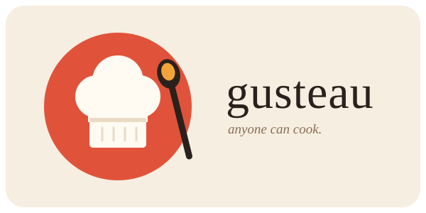

<div align="center">



# gusteau

**A taste layer for AI agents and harnesses.**<br>
*Anyone can cook.*

</div>

---

gusteau keeps your design taste in one place and hands it to whatever agent is building your UI. It sets up each new project with its own design sheet, gives the agent a short brief before it starts, and gives it a check to run until the work holds to the sheet. What you approve or correct along the way is recorded, so the next project starts from what you like.

It is a CLI and an MCP server, so it plugs into any harness, coding agent or assistant.

## Install

Needs [bun](https://bun.sh).

```sh
make
```

This builds a single binary at `dist/gusteau` and copies it to `~/.local/bin`. `make update` rebuilds and replaces it. To run from source instead, use `bun src/cli.ts <command>`.

## Two layers

| Layer | Where | Holds |
| --- | --- | --- |
| Global | `~/.gusteau/` (or `$GUSTEAU_HOME`) | rules, your preferences, reference sheets |
| Project | `./.gusteau/` | tokens, `DESIGN.md`, `DECISIONS.md`, `review.json`, project preferences, the component library |

Global sets the limits and the project picks the values. "Spacing sits on a 4px grid" is global; "spacing is 4, 8, 12, 20, 32" belongs to the project. When they disagree, the task request wins over the project, the project over global, and global over the built-in preset. A `hard` preference can't be overridden by a softer one.

## The loop

```sh
gusteau init "a booking app for a small climbing gym"
gusteau brief
gusteau check
```

`init` writes `.gusteau/` for the project: tokens (color, type, spacing, radius), a `DESIGN.md` with the goal and principles, and an empty decision log and library. Each project gets its own values. A new project doesn't reuse an earlier one's accent or fonts.

`brief` prints what an agent should read before UI work: the goal, the rules, your preferences, the project's tokens and decisions, the library, and a few quick checks.

`check` scans the code for values that aren't tokens: hex colors, sizes off the scale, and literals that copy a token instead of referencing it. It reads CSS, JS/TS/JSX/TSX, QML, HTML, Vue and Svelte. It also checks the component library for contradictions. Failures come out ranked by severity, with a suggested fix, and the command exits 1 until everything passes, so an agent can loop on it.

```sh
gusteau check --root ../app --tokens ../app/design/tokens.ts --limit 50
gusteau check --json
```

## Teaching it

```sh
gusteau learn --says "Hover changes value, never hue" --why "a hue shift reads as a different element" --strength hard
gusteau learn --from-project
gusteau candidates
gusteau promote <id>
```

Each preference keeps what it says, why, what to do instead, its scope and its strength. `--from-project` reads the project's `review.json` and `DECISIONS.md`. A project preference that shows up in two or more projects becomes a candidate for your global taste, and it moves there only when you `promote` it.

## References

When a request asks for another company's look ("make it feel like Linear"), the agent asks for that sheet by name:

```sh
gusteau ref linear
gusteau ref template
gusteau ref save linear linear.md
```

If there is no sheet yet, it prints `not found`. The agent researches that design, fills in the template and saves it. Next time it's there.

## Component library

```sh
gusteau component add "primary button" --level atom --role "main action" --tokens bg=color.accent,radius=radius.md
gusteau component search button
gusteau component list --level molecule
```

Components follow atomic design: atom, molecule, organism, template, page. Each records the tokens it uses and what it is built from.

## Primers

```sh
gusteau primer ux
```

Six short reminders: design elements, design principles, typography, color, layout and grids, UX. The brief carries only their quick checks; the full text is one command away.

## With an agent

Drop the instructions into the project's `AGENTS.md` or `CLAUDE.md`:

```sh
gusteau agents >> AGENTS.md
```

Or run it as an MCP server over stdio:

```json
{ "mcpServers": { "gusteau": { "command": "gusteau", "args": ["mcp"] } } }
```

The MCP tools are `brief`, `check`, `init`, `learn`, `ref_lookup`, `ref_template`, `ref_save`, `component_search`, `component_add` and `primer`.

## Absence over prohibition

gusteau steers by what it leaves out, not by what it forbids. The brief never names other projects, never lists the saved references, and never says "don't". A reference sheet comes back only when it is asked for by name. Each project's values are kept apart from earlier ones by the code that generates them, not by an instruction to the agent. An agent can't copy what it was never shown.

See [SPEC.md](SPEC.md) for the record formats and the details.
